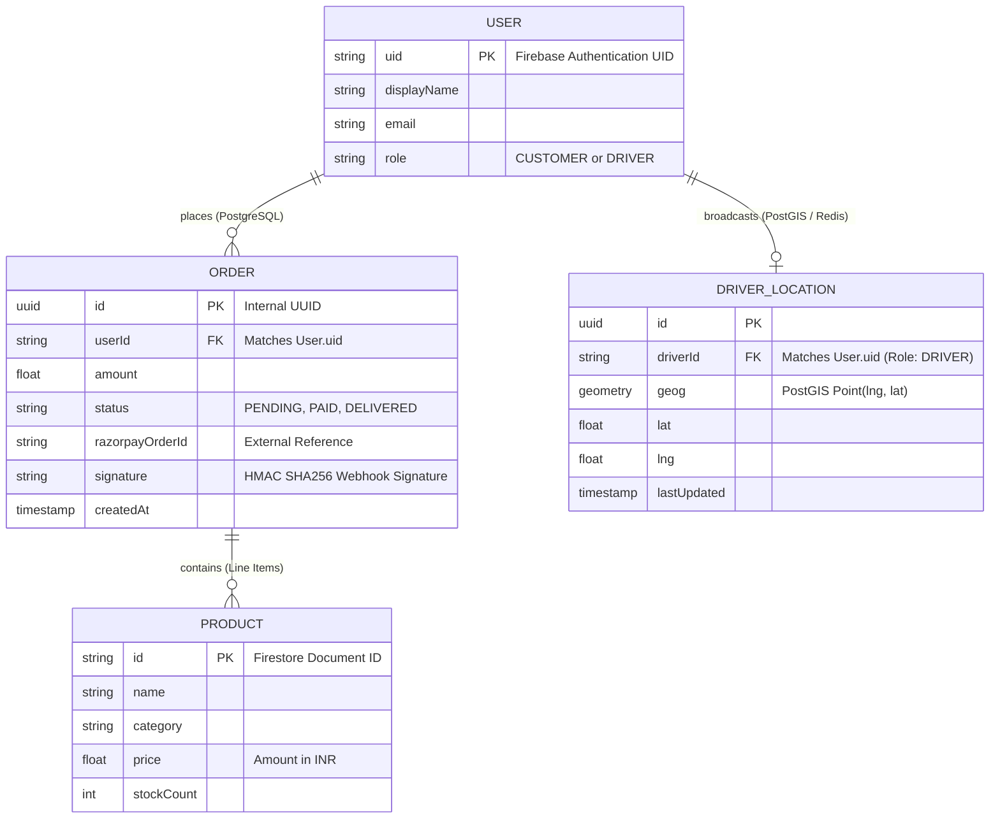

# Data Model

Beinn leverages a highly specialized hybrid data model split intelligently across Firestore (for client state synchronization) and PostgreSQL (for ACID transactions and geospatial queries).

## Entity Relationship Architecture

## Persistence Strategy

1. **Cloud Firestore (NoSQL)**: High read-throughput for catalog browsing and real-time stock updates. Clients subscribe to documents and collections directly.
2. **PostgreSQL (Relational)**: Ensures strong consistency and ACID guarantees for financial transactions via Razorpay webhooks.
3. **PostGIS**: Dedicated spatial engine for `ST_Distance` and `ST_DWithin` queries, determining optimal driver assignments.
4. **Redis**: Ephemeral tracking state before batched commits to PostGIS, preventing database IO exhaustion from high-frequency driver pings.
