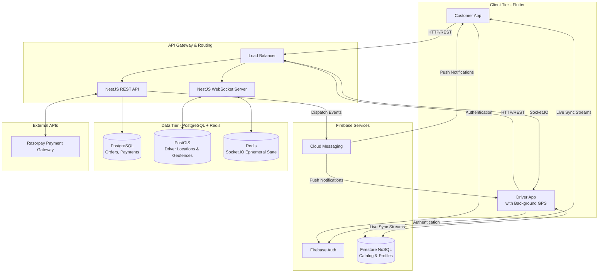

# System Architecture

This document provides a deep dive into the architectural design of the Beinn platform.

## High-Level Overview

Beinn is a hybrid architecture utilizing serverless real-time streams (Firebase) alongside a robust microservice backend (NestJS/PostgreSQL) to handle the complex requirements of e-commerce and local delivery.

### 1. Frontend (Flutter)
The mobile application is built with Flutter to ensure a consistent, 60fps native experience across iOS and Android. 
- **State Management:** Utilizes Riverpod/Provider for predictable state mutations.
- **Real-time Sync:** Listens to Cloud Firestore streams for live catalog and user profile updates.
- **Maps:** Integrates `flutter_map` for rendering OSM tiles and displaying real-time driver tracking.

### 2. Real-time Data Layer (Firebase)
- **Authentication:** Firebase Auth handles JWT issuance, Google OAuth, and session persistence.
- **Firestore:** Acts as the primary read database for the client. The product catalog, pricing, and basic profile info are synced here. It provides zero-latency updates to the app when stock changes.

### 3. Backend Services (NestJS)
The NestJS application acts as the authoritative source of truth for transactions and high-frequency data.
- **Order Management:** Interfaces with Razorpay to generate order IDs and securely verify payment webhooks.
- **Logistics & Dispatch:** Uses Socket.IO to receive high-frequency GPS pings from drivers, avoiding Firestore read/write quota limits.
- **Geospatial Engine:** Uses PostGIS extensions in PostgreSQL to perform `ST_DWithin` and `ST_Distance` queries to match the closest driver to an order.

### 4. Database Layer
- **PostgreSQL:** The transactional core. Stores strict relations for Orders, Payments, and Driver routing history.
- **Redis:** An in-memory cache used by the Socket.IO adapter to distribute WebSocket events and hold ephemeral driver states before batch-writing to PostgreSQL.

## Data Flow: Checkout & Delivery

1. **Cart Checkout:** User initiates checkout in Flutter. The app requests an Order ID from NestJS.
2. **Payment:** User completes Razorpay flow. Razorpay sends a webhook to NestJS.
3. **Verification:** NestJS verifies the webhook signature, creates the Order in PostgreSQL, and updates Firestore to notify the app of success.
4. **Dispatch:** NestJS queries PostGIS for the nearest driver and emits a Socket.IO event to that driver.
5. **Tracking:** Driver accepts, and their app begins streaming GPS coordinates to NestJS via WebSockets, which routes the data back to the customer's app for live map tracking.
